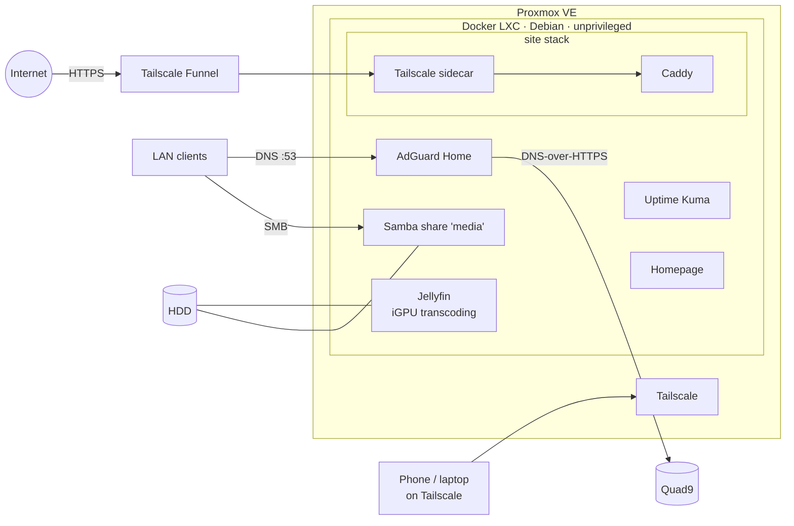

# homelab

My home server: an old desktop PC turned into a small Proxmox host that runs DNS filtering, media streaming, monitoring, a file share and a public website — without opening a single port on the router.

## Hardware

A repurposed office desktop: 2-core Intel CPU with integrated GPU (Quick Sync), 16 GB RAM, an SSD for the system and an HDD for media and backups.

## Architecture



## Services

| Service | Purpose | Access |
|---|---|---|
| [AdGuard Home](stacks/adguard) | Network-wide ad/tracker/malware blocking; upstream Quad9 via DNS-over-HTTPS | LAN DNS (`:53`), web UI LAN-only |
| [Jellyfin](stacks/jellyfin) | Media server with Intel Quick Sync hardware transcoding | LAN + Tailscale |
| [Uptime Kuma](stacks/uptime-kuma) | Uptime monitoring of all services incl. the public site | `:3001`, LAN + Tailscale |
| [Homepage](stacks/homepage) | Dashboard with links and live status | `:3010`, LAN |
| [site](stacks/site) | Static website, public via Tailscale Funnel, served by Caddy | Internet (HTTPS) |
| [Samba](samba/smb.conf) | `media` share for Windows, dedicated user, no guest access | LAN |
| Proxmox backups | Nightly backup of the Docker LXC to the HDD | — |

## Layout

```
proxmox/docker-lxc.conf LXC definition (unprivileged, nesting, iGPU passthrough, HDD bind mount)
samba/smb.conf          file share config
stacks/<service>/       one docker compose stack per service (/opt/stacks/<service> on the server)
```

Runtime data (`config/`, `data/`, `ts-state/`, …) and `.env` files are not part of the repo.

## Design decisions

- **One unprivileged LXC with Docker** instead of a VM per service: far less RAM overhead on a 2-core CPU; `nesting=1` + `keyctl=1` make Docker work inside the container.
- **iGPU passthrough into the LXC** (`dev0: /dev/dri/renderD128`) and `group_add: 992` in the Jellyfin stack → hardware transcoding instead of maxing out the CPU.
- **Host networking** for AdGuard (DNS on port 53 for the whole LAN) and Jellyfin (client auto-discovery); everything else uses normal port mappings.
- **Public website without port forwarding:** a Tailscale container in userspace mode publishes the site through Tailscale Funnel with automatic HTTPS. The home IP stays hidden, it works behind DS-Lite/CGNAT, and the stack is isolated from the other services.
- **Media is read-only for Jellyfin**; writes only go through the Samba share.

## Problems I ran into (and fixed)

**1. DNS loop in the LXC** — Docker could not pull images (`lookup registry-1.docker.io: i/o timeout`).
The LXC inherited the host's resolver, which after installing Tailscale on the host was MagicDNS (`100.100.100.100`) — only reachable on the host itself.
*Fix:* pinned the LXC's DNS to Quad9 via `pct set <id> --nameserver …`, restarted Docker. The server no longer depends on its own AdGuard to resolve names.

**2. Windows 11 refused the SMB share** — "organization's security policies block unauthenticated guest access".
Windows 11 24H2 blocks guest SMB logons; a wrong username was silently mapped to guest (`map to guest = Bad User`).
*Fix:* proper Samba password for the share user, `map to guest = never`, credentials stored in Windows Credential Manager. No Windows security settings were weakened.

**3. Website unreachable after renaming the node** — Caddy uses `network_mode: service:site-ts`; recreating only the Tailscale container left Caddy attached to the old network namespace.
*Fix:* always recreate the whole stack (`docker compose up -d --force-recreate`).

## Roadmap

- [ ] Vaultwarden (password manager)
- [ ] Pin image versions instead of `latest`, update via a reviewed process
- [ ] Internal HTTPS for LAN services through Caddy
- [ ] Off-site copy of the backups

## Usage

```bash
cd /opt/stacks/<service>
docker compose up -d
```
For the site stack: `cp .env.example .env`, add a Tailscale auth key, `chmod 600 .env`, and enable HTTPS + Funnel in the Tailscale admin console first.
