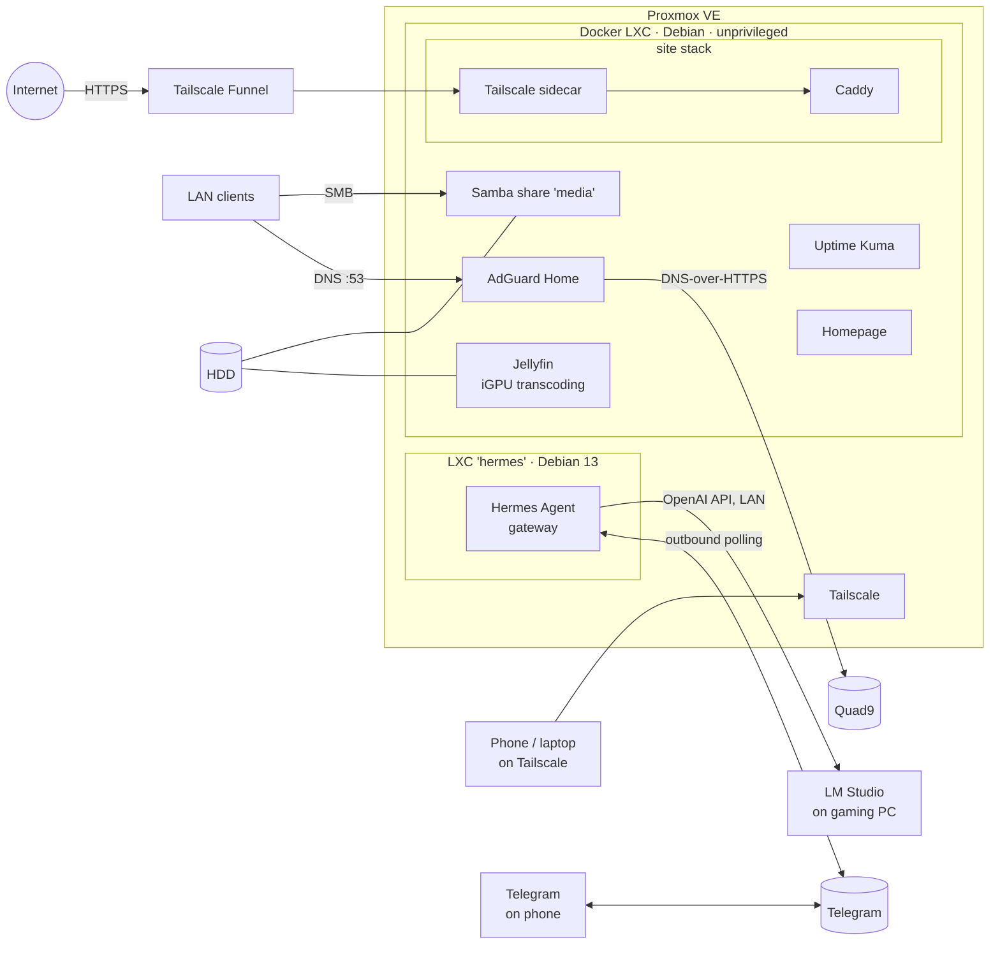

# homelab

my home server: an old desktop pc turned into a small proxmox host that runs dns filtering, media streaming, monitoring, a file share, a public website and a private ai agent — without opening a single port on the router.

## hardware

**server:** a repurposed office desktop: 2-core intel cpu with integrated gpu (quick sync), 16 gb ram, an ssd for the system and an hdd for media and backups.

**llm inference:** my main pc runs lm studio as the model backend for the agent — the server itself has no gpu worth using for that.

## architecture



## services

| service | purpose | access |
|---|---|---|
| [adguard home](stacks/adguard) | network-wide ad/tracker/malware blocking; upstream quad9 via dns-over-https | lan dns (`:53`), web ui lan-only |
| [jellyfin](stacks/jellyfin) | media server with intel quick sync hardware transcoding | lan + tailscale |
| [uptime kuma](stacks/uptime-kuma) | uptime monitoring of all services incl. the public site | `:3001`, lan + tailscale |
| [homepage](stacks/homepage) | dashboard with links and live status | `:3010`, lan |
| [site](stacks/site) | static website, public via tailscale funnel, served by caddy | internet (https) |
| [lain](stacks/lain) | discord music bot (lavamusic + lavalink, youtube plugin), patched to plain-text replies in a quiet voice, `lain play <link>` (`tanya` still works as a prefix) | discord only, no host ports |
| [samba](samba/smb.conf) | `media` share for windows, dedicated user, no guest access | lan |
| [hermes agent](hermes) | self-hosted ai agent, local model (gemma 4 12b qat) via lm studio on the gaming pc, chat through a private telegram bot | telegram (allowlisted user only) |
| proxmox backups | nightly backup of the docker lxc and the agent lxc to the hdd | — |

## layout

```
proxmox/docker-lxc.conf LXC definition (unprivileged, nesting, iGPU passthrough, HDD bind mount)
samba/smb.conf          file share config
docker/daemon.json      Docker daemon settings inside the LXC (log rotation)
deploy/                 auto-deploy: script + systemd timer (merge to main = deploy)
status/                 read-only status scripts for the agent's daily report
.github/workflows/      CI: secret scan (gitleaks) + compose file validation
hermes/                 AI agent LXC: setup notes + non-secret config examples
stacks/<service>/       one docker compose stack per service (/opt/stacks/<service> on the server)
```

runtime data (`config/`, `data/`, `ts-state/`, …), `.env` files and the website content are not part of the repo.

## design decisions

- **one unprivileged lxc with docker** instead of a vm per service: far less ram overhead on a 2-core cpu; `nesting=1` + `keyctl=1` make docker work inside the container.
- **igpu passthrough into the lxc** (`dev0: /dev/dri/renderD128`) and `group_add: 992` in the jellyfin stack → hardware transcoding instead of maxing out the cpu.
- **host networking** for adguard (dns on port 53 for the whole lan) and jellyfin (client auto-discovery); everything else uses normal port mappings.
- **public website without port forwarding:** a tailscale container in userspace mode publishes the site through tailscale funnel with automatic https. the home ip stays hidden, it works behind ds-lite/cgnat, and the stack is isolated from the other services.
- **pinned image versions + renovate prs** instead of `latest`: no surprise breakage from a random `docker compose pull`, every update is reviewed with its changelog and can be rolled back by reverting one commit.
- **bounded docker logs** ([docker/daemon.json](docker/daemon.json)): the default log driver grows without limit and would eventually fill the 30 gb container disk; `local` driver, 3 × 10 mb per container.
- **automatic os security updates in the docker lxc** (`unattended-upgrades`, debian + debian-security origins only): docker's own packages and the proxmox host stay manual, because those updates restart all containers or need a planned reboot.
- **media is read-only for jellyfin**; writes only go through the samba share.
- **ai agent in its own lxc, model on the gaming pc:** the agent can run commands, so it's isolated from the docker services; inference runs on the 16 gb gpu over the lan instead of on the 2-core server. details in [hermes/](hermes).

## problems i ran into (and fixed)

**1. dns loop in the lxc** — docker could not pull images (`lookup registry-1.docker.io: i/o timeout`).
the lxc inherited the host's resolver, which after installing tailscale on the host was magicdns (`100.100.100.100`) — only reachable on the host itself.
*fix:* pinned the lxc's dns to quad9 via `pct set <id> --nameserver …`, restarted docker. the server no longer depends on its own adguard to resolve names.

**2. windows 11 refused the smb share** — "organization's security policies block unauthenticated guest access".
current windows 11 blocks guest smb logons; a wrong username was silently mapped to guest (`map to guest = Bad User`).
*fix:* proper samba password for the share user, `map to guest = never`, credentials stored in windows credential manager. no windows security settings were weakened.

**3. website unreachable after renaming the node** — caddy uses `network_mode: service:site-ts`; recreating only the tailscale container left caddy attached to the old network namespace.
*fix:* always recreate the whole stack (`docker compose up -d --force-recreate`).

## roadmap

- [ ] vaultwarden (password manager)
- [x] pin image versions instead of `latest`, update via a reviewed process (renovate)
- [ ] internal https for lan services through caddy
- [x] restrict the lm studio port on the pc to the agent lxc only (windows firewall)
- [x] docker log rotation, ci secret scan + compose validation, security headers for the site
- [x] auto-deploy on merge (gitops via systemd timer)

**not doing (accepted risk):** off-site copy of the backups. they live on the same machine, so a dead hdd, theft or fire means losing them together with the original.

## restore

backups are proxmox `vzdump` archives. on the proxmox host:
```bash
pvesm list <backup-storage> --content backup          # find the archive
pct restore <new-id> <backup-storage>:backup/vzdump-lxc-<id>-<date>.tar.zst --storage local-lvm
pct start <new-id>
```
restoring under a **new** id first lets me test a backup without touching the running container (`pct destroy <new-id>` afterwards). worth repeating every few months — an untested backup is only a guess.

## deployment (gitops)

the server runs a checkout of this repo at `/opt/homelab` (`/opt/stacks` is a symlink to `stacks/`). a systemd timer ([deploy/](deploy)) checks `main` every 5 minutes and redeploys **only the stacks whose files changed**:

```
Renovate PR → CI (secret scan + compose validation) → I review & merge → server pulls → docker compose up -d
```

- nothing is merged automatically, so the review step stays the gate; merging *is* deploying.
- `git merge --ff-only`: if a file was edited by hand on the server, the deploy stops instead of overwriting it.
- a failed stack is retried on the next run; logs: `journalctl -u homelab-deploy`.

server-specific values (tailscale auth key, node name, allowed hosts) live in each stack's `.env` (see `.env.example`), the website content in `stacks/site/www/` — both stay on the server only.

**updates:** every image is pinned to an exact version. [renovate](renovate.json) checks weekly and opens a pull request per update (patch updates grouped).

**new stack / first start:** `cp .env.example .env`, fill it in, `chmod 600 .env`, `docker compose up -d`. for the site stack, enable https + funnel in the tailscale admin console first.
