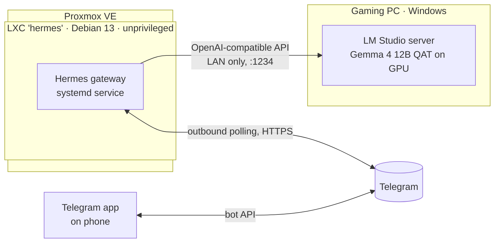

# hermes — self-hosted ai agent

[hermes agent](https://github.com/NousResearch/hermes-agent) (nous research) running in its own lxc on the proxmox host, reachable from my phone through a private telegram bot. the model runs **locally on my gaming pc** via lm studio — no cloud llm, no api costs, prompts never leave the house.

## how it fits together



| part | where | role |
|---|---|---|
| hermes agent + gateway | dedicated lxc (debian 13) | agent runtime, memory, skills, telegram connector |
| lm studio | my main pc | serves the model through its openai-compatible endpoint |
| model | gemma 4 12b, qat (quantization-aware trained 4-bit) | fits fully in 16 gb vram with room for context |
| telegram bot | telegram | chat interface from anywhere, no port forwarding |

## runtime benchmark (lm studio)

same model, settings and prompt (~380 tokens output, 32k context, all 48 layers on gpu, thinking off):

| runtime | generation | time to first token |
|---|---|---|
| **vulkan llama.cpp** | **58.9 tok/s** | **0.09 s** |
| rocm llama.cpp | 49.0 tok/s | 11.7 s |

→ **vulkan** is used: ~17 % faster and no warm-up delay. rocm was uninstalled.

thinking mode is left **off** for the agent: on a 12b model it multiplies response time for little quality gain.

## design decisions

- **separate lxc, not inside the docker lxc.** the agent can execute commands and edit files; keeping it in its own container limits the blast radius and lets me snapshot/restore it independently.
- **inference on the gaming pc, not on the server.** the server has a 2-core cpu and an igpu — useless for llms. the pc's 16 gb gpu runs a 12b model at interactive speed. trade-off: the agent only answers while the pc is on (accepted; it's a personal assistant, not a 24/7 service).
- **qat 4-bit weights** instead of a regular post-training quant: near full-precision quality at ~¼ of the memory.
- **telegram via outbound polling:** the gateway connects out to telegram, so nothing is exposed to the internet and it works behind ds-lite/cgnat, same as the website.
- **access locked down:** the gateway denies every user that isn't on the allowlist (`TELEGRAM_ALLOWED_USERS`, numeric user id, not @username). bot token and allowlist live in `~/.hermes/.env` on the container, never in this repo.

## setup (summary)

1. **lm studio (pc):** set the model's default **context length to at least 64k** (`65536`). hermes refuses to run below 64,000 tokens, and just-in-time loading uses the model's default settings. then start the server on port `1234`, enable *serve on local network*, *just-in-time model loading* and *run llm server on login*. check from the lxc:
   ```bash
   curl -s http://<pc-lan-ip>:1234/v1/models
   ```
2. **lxc:** debian 13 template, unprivileged, onboot. install hermes with the official installer, then point it at lm studio:
   ```bash
   hermes model            # → LM Studio / Custom endpoint → http://<pc-lan-ip>:1234/v1
   hermes config set timezone Europe/Berlin   # cron schedules use this
   hermes -z "Reply exactly HERMES_OK"
   ```
3. **telegram:** create a bot with @botfather, get my numeric id from @userinfobot, then:
   ```bash
   hermes gateway setup    # select Telegram, paste token + allowed user ID
   hermes gateway install  # as root: system service hermes-gateway.service
   ```
4. service and logs:
   ```bash
   systemctl restart hermes-gateway
   journalctl -u hermes-gateway -f   # or: hermes logs
   ```
5. **scheduled jobs:** `hermes cron list`, `hermes cron edit <id> --schedule "0 20 * * *"`, `hermes cron run <id>` to test.

see [`config.example.yaml`](config.example.yaml) and [`.env.example`](.env.example) for the non-secret shape of the config.

## daily status report (read-only)

every evening the agent posts a status report to telegram: containers and health, disks, ssd thin pool, last night's backups, auto-deploy state, pending os updates and open renovate prs.

- **no llm involved:** a cron job with `--no-agent` runs [`homelab-report.example.sh`](homelab-report.example.sh), so the report also arrives while the gaming pc is off and can't hallucinate an "all good".
- **read-only by construction, not by prompt:** the agent's ssh key is accepted by the docker lxc and the proxmox host only with a forced command (`restrict,command="…"` in `authorized_keys`). whatever the model types, the hosts only ever run [`status/status-docker.sh`](../status/status-docker.sh) / [`status/status-pve.sh`](../status/status-pve.sh).
- changes to the servers are never done by the local model; they go through reviewed pull requests.

## open items

- [x] windows firewall: tcp 1234 allowed **only** from the hermes lxc (private profile); lm studio's own broad allow rules disabled
- [x] dhcp reservations on the router for the agent lxc and the pc (stable endpoint + firewall rule)
- [ ] optional: wake-on-lan from the agent so it can wake the pc itself
- [x] included in the nightly proxmox backup job (agent memory, skills and config are restorable)
