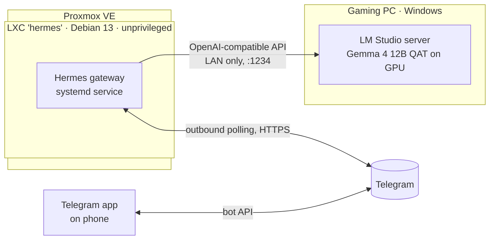

# hermes — self-hosted AI agent

[Hermes Agent](https://github.com/NousResearch/hermes-agent) (Nous Research) running in its own LXC on the Proxmox host, reachable from my phone through a private Telegram bot. The model runs **locally on my gaming PC** via LM Studio — no cloud LLM, no API costs, prompts never leave the house.

## How it fits together



| Part | Where | Role |
|---|---|---|
| Hermes Agent + gateway | dedicated LXC (Debian 13) | agent runtime, memory, skills, Telegram connector |
| LM Studio | my main PC | serves the model through its OpenAI-compatible endpoint |
| Model | Gemma 4 12B, QAT (quantization-aware trained 4-bit) | fits fully in 16 GB VRAM with room for context |
| Telegram bot | Telegram | chat interface from anywhere, no port forwarding |

## Runtime benchmark (LM Studio)

Same model, settings and prompt (~380 tokens output, 32k context, all 48 layers on GPU, thinking off):

| Runtime | Generation | Time to first token |
|---|---|---|
| **Vulkan llama.cpp** | **58.9 tok/s** | **0.09 s** |
| ROCm llama.cpp | 49.0 tok/s | 11.7 s |

→ **Vulkan** is used: ~17 % faster and no warm-up delay. ROCm was uninstalled.

Thinking mode is left **off** for the agent: on a 12B model it multiplies response time for little quality gain.

## Design decisions

- **Separate LXC, not inside the Docker LXC.** The agent can execute commands and edit files; keeping it in its own container limits the blast radius and lets me snapshot/restore it independently.
- **Inference on the gaming PC, not on the server.** The server has a 2-core CPU and an iGPU — useless for LLMs. The PC's 16 GB GPU runs a 12B model at interactive speed. Trade-off: the agent only answers while the PC is on (accepted; it's a personal assistant, not a 24/7 service).
- **QAT 4-bit weights** instead of a regular post-training quant: near full-precision quality at ~¼ of the memory.
- **Telegram via outbound polling:** the gateway connects out to Telegram, so nothing is exposed to the internet and it works behind DS-Lite/CGNAT, same as the website.
- **Access locked down:** the gateway denies every user that isn't on the allowlist (`TELEGRAM_ALLOWED_USERS`, numeric user ID, not @username). Bot token and allowlist live in `~/.hermes/.env` on the container, never in this repo.

## Setup (summary)

1. **LM Studio (PC):** set the model's default **context length to at least 64K** (`65536`). Hermes refuses to run below 64,000 tokens, and just-in-time loading uses the model's default settings. Then start the server on port `1234`, enable *Serve on Local Network*, *Just-in-Time model loading* and *Run LLM server on login*. Check from the LXC:
   ```bash
   curl -s http://<pc-lan-ip>:1234/v1/models
   ```
2. **LXC:** Debian 13 template, unprivileged, onboot. Install Hermes with the official installer, then point it at LM Studio:
   ```bash
   hermes model            # → LM Studio / Custom endpoint → http://<pc-lan-ip>:1234/v1
   hermes config set timezone Europe/Berlin   # cron schedules use this
   hermes -z "Reply exactly HERMES_OK"
   ```
3. **Telegram:** create a bot with @BotFather, get my numeric ID from @userinfobot, then:
   ```bash
   hermes gateway setup    # select Telegram, paste token + allowed user ID
   hermes gateway install  # as root: system service hermes-gateway.service
   ```
4. Service and logs:
   ```bash
   systemctl restart hermes-gateway
   journalctl -u hermes-gateway -f   # or: hermes logs
   ```
5. **Scheduled jobs:** `hermes cron list`, `hermes cron edit <id> --schedule "0 20 * * *"`, `hermes cron run <id>` to test.

See [`config.example.yaml`](config.example.yaml) and [`.env.example`](.env.example) for the non-secret shape of the config.

## Open items

- [x] Windows Firewall: TCP 1234 allowed **only** from the hermes LXC (Private profile); LM Studio's own broad allow rules disabled
- [x] DHCP reservations on the router for the agent LXC and the PC (stable endpoint + firewall rule)
- [ ] Optional: Wake-on-LAN from the agent so it can wake the PC itself
- [x] Included in the nightly Proxmox backup job (agent memory, skills and config are restorable)
